# Product & Architectural Roadmap (Single Source of Truth)

> 📌 **Master Roadmap Location:** For the comprehensive, platform-wide sequential timeline (M1 to M129) and active milestone tracking across both `Prateek_website` and `retriever`, see:
> 👉 **[`docs/UNIFIED_MASTER_ROADMAP.md`](docs/UNIFIED_MASTER_ROADMAP.md)**

---

## Quick Reference: Active Phases & Milestones

```mermaid
timeline
    title Master Development Timeline
    Phase A (M1–M30) : Core Platform Foundation & RAG Engine : Completed
    Phase B (M31–M45) : Multi-Tenant Auth, Security & Client Portals : Completed
    Phase C (M46–M53) : GraphRAG, RLM REPL, LLM Safety & 360 Deep Audit : Completed
    Phase D (M54–M56) : Surface Polish, Citation Visualizer & RLM Studio : Completed
    Phase E (M57–M60) : Autonomous Growth, Cold Outreach & AI Newsjacking : Completed
    Phase F (M61–M62) : Data Connectors & Vision OCR Ingestion : Completed
    Phase G (M63–M68) : SOTA Productized E-Commerce Scoping & Agency Ecosystem : Completed
    Phase H (M69–M73) : SOTA Cognitive RAG Algorithm R&D : Completed
    Phase I (M74–M78) : Enterprise Cognitive Evaluation & Deep Observability : Completed
    Phase J (M79–M85) : Machine Learning & Predictive Intelligence Framework : Completed
    Phase J.5 (M85.1–M85.4) : Forensic Audit Remediation — Parity : Completed
    Phase J.6 (M85.5–M85.10) : Production Hardening & Credibility : Completed
    Phase J.7 (M85.11–M85.17) : Honest AI Wiring & Trust Hardening : Completed
    Phase K (M86–M90) : Enterprise Scale, Edge Replication & Universal Plugins : Completed
    Phase L (M91–M97) : Forward Deployed Engineering (FDE) Agentic Stack : Completed
    Phase M (M98–M102) : Sovereign Edge & Multi-Cloud Resiliency : Completed
    Phase N (M103–M109) : Autonomous Agent Swarms, Long-Horizon Memory & Multi-Agent Quorum : Completed
    Phase O (M110–M113) : Public Open-Source Launch & Community Ecosystem : Completed
    Phase P (M114–M129) : Multimodal Voice, Distributed Mesh & Autonomous Cognitive Batteries : Completed
    Phase Q (M130+) : Instant Cloud Playground & Multi-Region Sandbox Hub : Planned
```

---

## Active Milestone Sequence (Phase P: M114 – M129 & Phase Q: M130+)

| Milestone | Title | Focus Area | Status | Detailed Specification |
|:---|:---|:---|:---|:---|
| **M86** | Edge AI Token Shield, DDoS Defense & Upstash Rate Limiting | Dual-mode sliding-window token limiter & resilient SSE reconnect | **Completed** | [`docs/UNIFIED_MASTER_ROADMAP.md`](docs/UNIFIED_MASTER_ROADMAP.md#milestone-86-edge-ai-token-shield-ddos-defense--upstash-redis-rate-limiting) |
| **M86.5** | Platform Capabilities & Active Batteries Observability Cockpit | Canonical platform batteries inventory and live telemetry command center | **Completed** | [`docs/UNIFIED_MASTER_ROADMAP.md`](docs/UNIFIED_MASTER_ROADMAP.md#milestone-865-platform-capabilities--active-batteries-observability-cockpit) |
| **M87** | Automated Cloud Database Snapshots & PITR Engine | AES-256 encrypted table streamer & zero-downtime `--dry-run` PITR recovery | **Completed** | [`docs/UNIFIED_MASTER_ROADMAP.md`](docs/UNIFIED_MASTER_ROADMAP.md#milestone-87-automated-cloud-database-snapshots-s3r2-wal-archival--pitr-recovery-engine) |
| **M88** | Enterprise Compliance Vault: Presidio PII & GDPR Wipe | Luhn entity sanitizer & HMAC-SHA256 deletion certificate authority | **Completed** | [`docs/UNIFIED_MASTER_ROADMAP.md`](docs/UNIFIED_MASTER_ROADMAP.md#milestone-88-enterprise-compliance-vault-presidio-pii-redaction--gdpr-cryptographic-wipe) |
| **M89** | Geo-Distributed Multi-Region Edge Vector Read-Replicas | Geo-IP latency router & CQRS read-replica connection pooler | **Completed** | [`docs/UNIFIED_MASTER_ROADMAP.md`](docs/UNIFIED_MASTER_ROADMAP.md#milestone-89-geo-distributed-multi-region-edge-vector-read-replicas) |
| **M90** | Universal Ecosystem Plugins (Slack Bot, Chrome Ext, GDrive Sync) | Native Slack bot `/ask-retriever`, Manifest V3 extension & 2-way sync | **Completed** | [`docs/UNIFIED_MASTER_ROADMAP.md`](docs/UNIFIED_MASTER_ROADMAP.md#milestone-90-universal-ecosystem-plugins-slack-bot-chrome-extension--2-way-gdrive-sync) |
| **M91** | LangGraph Cyclic Agentic Workflows & HITL State Engine | Stateful cyclic graphs, PostgreSQL checkpoints & human approval gates | **Completed** | [`docs/UNIFIED_MASTER_ROADMAP.md`](docs/UNIFIED_MASTER_ROADMAP.md#milestone-91-langgraph-cyclic-agentic-orchestration--human-in-the-loop-hitl-state-engine) |
| **M92** | DSPy Declarative Prompt Compilation & Teleprompter | Retired un-installed DSPy facade (`R2.3`); `SqlPromptTemplateRegistry` retained | **Archived / Purged** | [`docs/UNIFIED_MASTER_ROADMAP.md`](docs/UNIFIED_MASTER_ROADMAP.md) |
| **M93** | Enterprise LLM Gateway & Multi-Model Smart Router | Live gateway routing, dynamic model failover, real provider health probes & quota attribution | **Completed** | [`docs/UNIFIED_MASTER_ROADMAP.md`](docs/UNIFIED_MASTER_ROADMAP.md#milestone-93-enterprise-llm-gateway--multi-model-smart-router-litellm-architecture) |
| **M94** | Programmable Rule & Colang-Style Guardrails | Postgres RLS persisted rule/Colang flow parser, sub-20ms input rails & configurable safety guard (`R3.4`) | **Completed** | [`docs/UNIFIED_MASTER_ROADMAP.md`](docs/UNIFIED_MASTER_ROADMAP.md) |
| **M95** | Durable Asynchronous Execution & AI Workflow Engine | Retired theatrical state-machine facade (`R2.11`); visual DAG (`M126`) + Celery workers handle orchestration | **Archived / Purged** | [`docs/UNIFIED_MASTER_ROADMAP.md`](docs/UNIFIED_MASTER_ROADMAP.md) |
| **M96** | Serverless GPU Serving & Custom vLLM / LoRA Deployment Pipeline | Fail-closed Modal / BentoML serverless GPU client (HTTP 503 when unconfigured) & Postgres embedding LoRA adapters | **Completed** | [`docs/UNIFIED_MASTER_ROADMAP.md`](docs/UNIFIED_MASTER_ROADMAP.md#milestone-96-serverless-gpu-serving--custom-vllm--lora-deployment-pipeline-modal--bentoml) |
| **M97** | Autonomous FDE Metaprogrammer & Capability Studio | Retired dynamic code scaffolder in favor of static AST Hexagonal enforcement (ADR 33) | **Archived / Purged** | [`docs/UNIFIED_MASTER_ROADMAP.md`](docs/UNIFIED_MASTER_ROADMAP.md#milestone-97-autonomous-fde-metaprogrammer--self-extending-capability-studio) |
| **M98** | Sovereign Edge SQLite / Turso Vector Synchronization & Offline Agent | Embedded SQLite 3 FTS5, binary float32 BLOB vectors, differential delta sync & Battery #14 | **Completed** | [`docs/UNIFIED_MASTER_ROADMAP.md`](docs/UNIFIED_MASTER_ROADMAP.md#milestone-98-sovereign-edge-sqlite--turso-vector-synchronization--offline-first-edge-agent) |
| **M99** | Distributed Multi-Cloud Failover & Edge Turso LibSQL Replication | Retired in favor of single-region PostgreSQL + pgvector core (ADR 35) | **Archived / Purged** | [`docs/UNIFIED_MASTER_ROADMAP.md`](docs/UNIFIED_MASTER_ROADMAP.md#milestone-99-distributed-multi-cloud-failover--purged--superseded-by-single-region-core) |
| **M100** | Sovereign Edge Voice & Local Whisper / WebRTC Speech Synthesis | Retired in-process audio facade (`R2.1`); voice builds scoped explicitly via LiveKit/Deepgram | **Archived / Purged** | [`docs/UNIFIED_MASTER_ROADMAP.md`](docs/UNIFIED_MASTER_ROADMAP.md) |
| **M101** | Zero-Trust Micro-Enclave Encryption & Hardware KMS Remote Attestation | Retired in-memory enclave simulation; anchored to Signed Merkle Attestation (ADR 37) | **Archived / Purged** | [`docs/UNIFIED_MASTER_ROADMAP.md`](docs/UNIFIED_MASTER_ROADMAP.md#milestone-101-zero-trust-micro-enclave-encryption--purged--see-adr-37) |
| **M102** | Autonomous Edge Fleet Swarm Mesh & P2P Gossip Replication | Retired in-memory gossip simulation; superseded by `MultiAgentConsensusEngine` (`M48`) | **Archived / Purged** | [`docs/UNIFIED_MASTER_ROADMAP.md`](docs/UNIFIED_MASTER_ROADMAP.md#milestone-102-autonomous-edge-fleet-swarm-mesh--purged--see-adr-38) |
| **M103** | Universal Model Context Protocol (MCP) Server & Platform Tool Registry | Expose surviving platform tools via JSON-RPC 2.0 MCP (SSE/Stdio) & Battery #15 | **Completed** | [`docs/UNIFIED_MASTER_ROADMAP.md`](docs/UNIFIED_MASTER_ROADMAP.md#milestone-103-universal-model-context-protocol-mcp-server--platform-tool-registry) |
| **M104** | Autonomous Multi-Turn ReAct Tool Loop & Self-Healing Runtime | Dynamic cyclic Reason-Act-Observe loop, trace memory, self-correction & Battery #16 | **Completed** | [`docs/UNIFIED_MASTER_ROADMAP.md`](docs/UNIFIED_MASTER_ROADMAP.md#milestone-104-autonomous-multi-turn-react-tool-loop--self-healing-execution-engine) |
| **M105** | Smart Tool Gateway & Multi-Model Economic Orchestrator | Hybrid routing: mid-tier LLMs for routine tool calls, dynamic escalation to frontier models | **Completed** | [`docs/UNIFIED_MASTER_ROADMAP.md`](docs/UNIFIED_MASTER_ROADMAP.md#milestone-105-smart-tool-gateway--multi-model-economic-orchestrator) |
| **M106** | Studio Tool Surface Cockpit & MCP Interactive Playbuilder | SaaS Studio API key & gateway surfaces, live ReAct traces & MCP client snippets | **Completed** | [`docs/UNIFIED_MASTER_ROADMAP.md`](docs/UNIFIED_MASTER_ROADMAP.md#milestone-106-studio-tool-surface-cockpit--mcp-interactive-playbuilder) |
| **M107** | Zero-Toy Invariant Enforcement & Fail-Fast Hardening across All Subsystems | Forensic AST linter (`audit_zero_toy.py`) banning facades, fake sleep probes, mock tokens & unauthenticated tenant routes (`R5.1`) | **Completed** | [`docs/UNIFIED_MASTER_ROADMAP.md`](docs/UNIFIED_MASTER_ROADMAP.md#milestone-107-zero-toy-invariant-enforcement--fail-fast-hardening-across-all-subsystems) |
| **M108** | Cognitive Agent Memory Consolidation & Long-Horizon Experience Distillation | 768-dim pgvector Postgres persistence (`PgCognitiveMemoryRepository`), Ebbinghaus decay, ReAct guidance injection & Battery #17 | **Completed** | [`docs/UNIFIED_MASTER_ROADMAP.md`](docs/UNIFIED_MASTER_ROADMAP.md#milestone-108-cognitive-agent-memory-consolidation--long-horizon-experience-distillation) |
| **M109** | Multi-Agent Swarm Quorum & Dynamic Debate Consensus Engine | Retired rigged debate facade (`R2.8`); replaced in Battery #18 by real `MultiAgentConsensusEngine` (`M48`) | **Archived / Purged** | [`docs/UNIFIED_MASTER_ROADMAP.md`](docs/UNIFIED_MASTER_ROADMAP.md) |
| **M110** | Public Open-Source Launch (`v1.0.0-rc1`) & Decoupled SDKs | 1-line quickstart, Docker Compose stack, `@prat3010/retriever-client` on npm & `retriever-python` on PyPI | **Completed** | [`docs/UNIFIED_MASTER_ROADMAP.md`](docs/UNIFIED_MASTER_ROADMAP.md#milestone-110-public-open-source-launch-v100-rc1--decoupled-sdks) |
| **M111** | Community Connectors Ecosystem & Change-Data-Capture (CDC) Pipeline | Relational DB CDC, S3/R2 object storage, GitHub/Slack live connectors (no offline sandboxes) & Battery #19 | **Completed** | [`docs/UNIFIED_MASTER_ROADMAP.md`](docs/UNIFIED_MASTER_ROADMAP.md#milestone-111-community-connectors-ecosystem--change-data-capture-cdc-pipeline) |
| **M112** | Production Helm Charts (v1.2.0-alpha1) | Production Helm 3 chart (`deploy/helm/retriever/`); in-memory Kubernetes Operator simulator purged (`R2.2`) | **Consolidated** | [`docs/UNIFIED_MASTER_ROADMAP.md`](docs/UNIFIED_MASTER_ROADMAP.md) |
| **M113** | Multimodal Vision GraphRAG & Schematic Ingestion (v1.3.0-alpha1) | SVG/JSON parsing + Vision LLM schematic extraction (fail-closed HTTP 415/503) & Battery #20 | **Completed** | [`docs/UNIFIED_MASTER_ROADMAP.md`](docs/UNIFIED_MASTER_ROADMAP.md#milestone-113-multimodal-vision-graphrag--schematic-ingestion-v130-alpha1) |
| **M114** | Real-time Audio Streaming & Full-Duplex WebRTC Voice Agent | Retired simulated PCM16/Whisper stack (`R2.1`) | **Archived / Purged** | [`docs/UNIFIED_MASTER_ROADMAP.md`](docs/UNIFIED_MASTER_ROADMAP.md) |
| **M118** | Signed Merkle Vector Attestation & Verifiable Grounding (v1.8.0-alpha1) | PostgreSQL RLS Merkle trees (`merkle_document_roots`, `grounding_certificates`), Ed25519 signatures (`/v1/attestation/*`) & Battery #21 | **Completed** | [`docs/UNIFIED_MASTER_ROADMAP.md`](docs/UNIFIED_MASTER_ROADMAP.md) |
| **M119** | Enterprise Identity Federation (SAML 2.0 / SCIM 2.0) & RB-VAC (v1.9.0-alpha1) | Postgres-backed SAML 2.0 SSO, SHA-256 SCIM 2.0 directory sync, pre-retrieval RB-VAC pruning & Battery #22 | **Completed** | [`docs/40_Enterprise_Identity_Federation_and_RBVAC_PRD.md`](docs/40_Enterprise_Identity_Federation_and_RBVAC_PRD.md) |
| **M120** | Automated Continuous DPO / ORPO Tuning Pipeline | Retired in-memory linear tuning simulator (`R2.6`); real InfoNCE embedding LoRA wired in `HybridSearchService` (`R3.2`) | **Archived / Purged** | [`docs/UNIFIED_MASTER_ROADMAP.md`](docs/UNIFIED_MASTER_ROADMAP.md) |
| **M122** | Autonomous Continuous Benchmark & Regression Gatekeeper | Retired in-memory gatekeeper simulator & stub eval tasks (`R2.7`); `EvalRunService` + `NliEvaluator` hardened (`R3.10`) | **Archived / Purged** | [`docs/UNIFIED_MASTER_ROADMAP.md`](docs/UNIFIED_MASTER_ROADMAP.md) |
| **M123** | Hierarchical Memory & Graph-of-Thoughts (GoT) Planning | Retired heuristic GoT planner (`R2.9`, dropped `got_*` tables); `CognitiveMemoryEngine` (`M108`) wired cleanly to Postgres (`R3.7`) | **Archived / Purged** | [`docs/UNIFIED_MASTER_ROADMAP.md`](docs/UNIFIED_MASTER_ROADMAP.md) |
| **M124** | Agent-Native Enterprise Modernization & Dual-Channel Fan-Out (v2.3.0-alpha1) | PostgreSQL RLS cognitive persistence, concurrent HNSW+BM25 fan-out, lexical/opt-in ONNX MaxSim & circuit-breaker embedder | **Completed** | [`docs/UNIFIED_MASTER_ROADMAP.md`](docs/UNIFIED_MASTER_ROADMAP.md#milestone-124-agent-native-enterprise-modernization-cognitive-persistence-dual-channel-fan-out--resilient-inference) |
| **M125** | Turn-Key Enterprise SaaS Connectors & Document-Level ACL Inheritance (v2.3.0) | Google Workspace, Notion, Confluence/Jira, Microsoft 365 delta crawlers, JSONB ACL (?\|) filtering & Battery #23 | **Completed** | [`docs/45_Enterprise_SaaS_Connectors_and_ACL_Inheritance_PRD.md`](docs/45_Enterprise_SaaS_Connectors_and_ACL_Inheritance_PRD.md) |
| **M126** | Visual DAG Workflow Canvas & Agentic Graph Composer (v2.4.0) | Interactive SVG studio, Kahn's cycle detection, live Search/LLM/Guardrail execution & Battery #24 | **Completed** | [`docs/46_Visual_DAG_Workflow_Canvas_PRD.md`](docs/46_Visual_DAG_Workflow_Canvas_PRD.md) |
| **M128** | System 1 Fast-Path Decision Plane & TypeSafe Jev Integration (v2.6.0) | Non-autoregressive intent classification, CRAG verification, zero-token routing & Battery #25 | **Completed** | [`docs/UNIFIED_MASTER_ROADMAP.md`](docs/UNIFIED_MASTER_ROADMAP.md#milestone-128-system-1-fast-path-decision-plane--typesafe-jev-integration) |
| **M129** | Tenant AI Persona Engine & Enterprise Governance Policy Lock (v2.7.0) | Self-service tenant prompt REST API, cluster administrator policy lock (`is_locked: bool`), HTTP 403 enforcement & Admin Web Studio integration | **Completed** | [`docs/UNIFIED_MASTER_ROADMAP.md`](docs/UNIFIED_MASTER_ROADMAP.md#milestone-129-tenant-ai-persona-engine--enterprise-governance-policy-lock) |
| **M130** | Instant Cloud Playground & Multi-Region Sandbox Hub (v2.8.0) | Ephemeral 1-click 30-minute sandbox tenants with pre-ingested corpora, interactive rate-limited REST playground & public benchmark leaderboard | **Planned** | [`docs/48_The_Playground_Universal_Creation_Showcase_PRD.md`](docs/48_The_Playground_Universal_Creation_Showcase_PRD.md) |

---

## Domain Technical Specifications & PRDs

For deep technical implementation details, schemas, API contracts, and component architectures:
- **Scoping Engine & Client Workspace Dashboard PRD:** [`docs/25_SOTA_Scoping_Engine_PRD.md`](docs/25_SOTA_Scoping_Engine_PRD.md)
- **RAG SaaS Studio Workspace PRD:** [`docs/24_RAG_App_Studio_PRD.md`](docs/24_RAG_App_Studio_PRD.md)
- **Enterprise Identity Federation & RB-VAC PRD:** [`docs/40_Enterprise_Identity_Federation_and_RBVAC_PRD.md`](docs/40_Enterprise_Identity_Federation_and_RBVAC_PRD.md)
- **Enterprise SaaS Connectors & ACL Inheritance PRD:** [`docs/45_Enterprise_SaaS_Connectors_and_ACL_Inheritance_PRD.md`](docs/45_Enterprise_SaaS_Connectors_and_ACL_Inheritance_PRD.md)
- **Visual DAG Workflow Canvas & Agentic Graph Composer PRD:** [`docs/46_Visual_DAG_Workflow_Canvas_PRD.md`](docs/46_Visual_DAG_Workflow_Canvas_PRD.md)
- **The Playground Universal Creation Showcase PRD:** [`docs/48_The_Playground_Universal_Creation_Showcase_PRD.md`](docs/48_The_Playground_Universal_Creation_Showcase_PRD.md)
- **Client Workspace Architecture & Contracts:** [`docs/CLIENT_DASHBOARD_ROADMAP.md`](docs/CLIENT_DASHBOARD_ROADMAP.md)
- **Autonomous Outreach Agent Technical Spec:** [`docs/AI_OUTREACH_AGENT_ROADMAP.md`](docs/AI_OUTREACH_AGENT_ROADMAP.md)
- **Automated AI Blogging Engine Spec:** [`docs/AUTOMATED_AI_BLOGGING_ROADMAP.md`](docs/AUTOMATED_AI_BLOGGING_ROADMAP.md)

