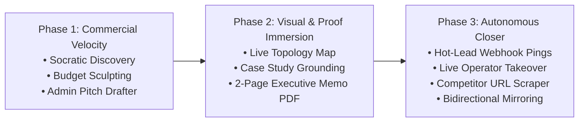

# 🚀 SOTA Scoping Copilot: Master Product Roadmap (2026–2027)

> **Document Classification:** Master Production Specification & Technical Roadmap  
> **Subsystem:** Scoping Lab Conversational Solutions Architect (`InlineScopingChatCard`, `/api/scoping/chat`, Retriever Control Plane)  
> **Core Objective:** Evolve the Scoping Lab chatbot from a reactive catalog helper into an autonomous, SOTA solutions architect that qualifies leads, sculpts budgets, generates executive proof, and closes deals.

---

## 🧭 Executive Overview & Phased Trajectory

---

## 📌 Phase 1: Tactical Commercial Wins (Immediate High-ROI Velocity) — [COMPLETED ✅]

*Focus: Maximize conversion of existing site traffic by replacing single-turn guessing with consultative authority, budget negotiation, and fast outreach triage.*

### Milestone 1.1: Multi-Turn Socratic Discovery & Phased MVP Splitting [COMPLETED ✅]
* **Implementation:**
  * Updated [`src/app/api/scoping/chat/route.ts`](../src/app/api/scoping/chat/route.ts) with `computePhasedBreakdown` returning structured `phase1` (Lean MVP) vs `phase2` (Scale & Automation) deliverables, pricing, and timelines inside `<blueprint_action>`.
  * Added Socratic diagnostic alignment questions for underspecified requests to clarify audience, authorization, and data ingestion needs.
  * Updated [`src/components/Intake/InlineScopingChatCard.tsx`](../src/components/Intake/InlineScopingChatCard.tsx) to render dual Phase 1 MVP vs Full Roadmap action cards with dedicated 1-click apply buttons (`👉 Apply Phase 1 MVP` vs `👉 Apply Full Scope`).

### Milestone 1.2: Dynamic Budget Sculpting & Scope De-escalation [COMPLETED ✅]
* **Implementation:**
  * Added budget negotiation classification in `/api/scoping/chat` (detecting keywords like `under $`, `budget`, `cut costs`, `cheaper`, `lean mvp`).
  * Created Quick Prompt preset: `💡 Sculpt Lean MVP (< $3,000 / ₹2.5L)` directly on the chat card interface.
  * Deterministically calculates de-escalated Phase 1 price using the catalog engine pricing (`calcQuote`), isolating essential domain modules from deferred automation features.

### Milestone 1.3: 1-Click Tailored Pitch Drafter in `/admin` [COMPLETED ✅]
* **Implementation:**
  * Created endpoint [`src/app/api/admin/draft-pitch/route.ts`](../src/app/api/admin/draft-pitch/route.ts) with strict admin session authorization (`getVerifiedSessionEmail` + `isAdminEmail`).
  * Integrates with Gemini API (`gemini-3.6-flash` / `gemini-2.5-flash`) with fallback proposals tailored to the lead's base engine, active modules, and chat inquiry pain points.
  * In [`src/app/admin/page.tsx`](../src/app/admin/page.tsx), added `AI Executive Proposal Drafter` to the lead transcript drawer with inline editable Subject and Body, "📋 Copy Proposal to Clipboard", "📤 Send to Lead via Resend", and "🔄 Regenerate" controls.

---

## 🎨 Phase 2: Visual & Proof Immersion (Deep Technical Credibility)

*Focus: Overwhelm clients with technical authority and institutional trust by rendering visual architecture models and linking real past case studies.*

### Milestone 2.1: Architecture Topology Bridge & Live Tier Inspection
* **Context & True Architecture:** Step 2 (`StepTechnicalScope.tsx`) already features a production-grade, interactive 5-tier visual architecture topology map (`ArchitectureTopologyMap.tsx`) with real-time node lighting, SLA tooltips, layman explanations, and full-screen expansion. Building a redundant, static Mermaid text diagram inside the chat window would clutter the conversational flow and duplicate existing capabilities.
* **Architecture & Copilot Integration:**
  * **Dynamic Topology Sync:** When the Copilot emits `<blueprint_action>` (or when the user applies Phase 1 MVP / Full Scope), the changes instantly illuminate the corresponding nodes, edges, and tiers on `ArchitectureTopologyMap` in Step 2.
  * **Direct In-Chat Topology Anchor:** Each blueprint card prominently features a **"🗺️ Inspect in Architecture Topology Map"** action button (leveraging `onNavigateStep(2)`), smoothly transitioning the user directly to the illuminated Step 2 canvas.
  * **Contextual Tier Guidance:** When accessed from Step 2 (via `ScopeCopilotDrawer`), the Copilot analyzes active vs inactive topology tiers (Visitor, Security, Commerce, AI, Data) and proactively recommends missing architectural safeguards (e.g. suggesting Redis semantic caching to drop P95 vector search latency from 800ms to 12ms).

### Milestone 2.2: Portfolio Proof Grounding (Case Study Injection)
* **Problem:** The chatbot sounds like a generic LLM rather than Prateek Sharma's dedicated Lead Solutions Architect.
* **Architecture:**
  * Ingest the actual portfolio projects (`projects.json`), GitHub case studies, and `/playground` interactive tools into the `prateeq_scoping` Retriever tenant.
  * When a user asks about complex capabilities (WebSockets, RAG, pgvector, real-time audio), the copilot cites concrete proof:
    > *"Prateek has implemented this exact pattern: our Retriever SaaS engine uses pgvector hybrid search and sub-200ms audio streaming. You can test a live working demo right now in the [Playground](/playground)."*

### Milestone 2.3: 1-Click "Executive Scoping Memo" PDF Export
* **Problem:** Clients must navigate through 4 form steps to download a proposal PDF.
* **Architecture:**
  * Add an in-chat button: **"📄 Download Executive Scoping Memo (PDF)"**.
  * Uses `@react-pdf/renderer` to immediately generate a branded 2-page executive summary PDF containing:
    1. Problem Statement & Monetization Strategy.
    2. Architecture Topology Diagram & Tech Stack Rationale.
    3. Itemized Fixed-Cost Investment (INR/USD) and 30-Day Bug Warranty.

---

## ⚡ Phase 3: Autonomous Closer & Real-Time Intelligence (State of the Art)

*Focus: Omnichannel interception, live human operator takeover, and automated competitor stack reverse-engineering.*

### Milestone 3.1: Instant Telegram / Discord "Hot Lead" Pings
* **Problem:** Admins only learn about high-intent prospects hours later when checking dashboard emails.
* **Architecture:**
  * Telemetry evaluates intent in real-time. If a conversation:
    1. Contains `> 3` message exchanges, and
    2. Has a calculated total of `> $2,500` / `> ₹2,00,000`, or
    3. Mentions high-urgency keywords (*"need this month"*, *"have budget"*, *"investor funded"*),
  * Dispatches an immediate webhook to Prateek's private Telegram or Discord bot:
    > *"🚨 Hot Deal Chatting: Founder from New York inquiring about B2B SaaS MVP ($5,100). [Tap to view live session]"*

### Milestone 3.2: Human-in-the-Loop "Take Over Live Chat" (Ghost Operator)
* **Problem:** When an enterprise client is ready to buy, an automated bot cannot replace human closing rapport.
* **Architecture:**
  * Admin dashboard receives real-time SSE stream of active conversations.
  * Prateek can click **"Join Live Conversation"**.
  * Chat UI seamlessly indicates: *"Lead Architect Prateek Sharma joined the session"*.
  * Admin messages are delivered live to the client's screen via Supabase Realtime / WebSockets.

### Milestone 3.3: Competitor & Reference URL Scraper
* **Problem:** Non-technical founders struggle to explain technical features; they say *"I want a clone of Gumroad"* or *"Build me Loom for real estate"*.
* **Architecture:**
  * Add a URL input field inside the chat: *"Paste a reference website or competitor"*.
  * An automated headless scraper extracts metadata, auth gates, navigation hierarchy, and technology signatures (via Wappalyzer / tech fingerprinting).
  * The copilot infers the architectural specifications and auto-generates the corresponding fixed-price quote blueprint.

### Milestone 3.4: Bidirectional Wizard Mirror (Two-Way Reactivity)
* **Problem:** Leaving Step 1 to customize modules in Step 2 causes the chat to become disconnected.
* **Architecture:**
  * When the client toggles modules in Step 2 or changes brand kits in Step 3, the wizard state feeds back into the copilot context.
  * When returning to Step 1 or opening the slide-over chat:
    > *"I noticed you added Stripe Payments and removed Video Vault in Step 2. That adjusted your total to **$3,400**. Would you like me to recommend a matching care plan?"*

---

## 📊 Strategic Implementation Matrix

| Milestone | Complexity | Commercial Value | Target Milestone Phase |
| :--- | :---: | :---: | :---: |
| **1.1 Socratic Clarification & Phased MVP** | Medium | ⭐⭐⭐⭐⭐ | Next Sprint |
| **1.2 Dynamic Budget Sculpting** | Low | ⭐⭐⭐⭐⭐ | Next Sprint |
| **1.3 AI Tailored Pitch Drafter in `/admin`** | Low | ⭐⭐⭐⭐⭐ | Immediate |
| **2.1 Topology Map Bridge & Tier Guidance** | Low | ⭐⭐⭐⭐ | Phase 2 |
| **2.2 Portfolio Proof Grounding** | Medium | ⭐⭐⭐⭐ | Phase 2 |
| **2.3 In-Chat Executive Memo PDF** | Medium | ⭐⭐⭐⭐ | Phase 2 |
| **3.1 Telegram Hot-Lead Webhook** | Low | ⭐⭐⭐⭐⭐ | Phase 3 |
| **3.2 Live Operator Takeover** | High | ⭐⭐⭐⭐ | Phase 3 |
| **3.3 Competitor URL Ingestion** | High | ⭐⭐⭐ | Phase 3 |
| **3.4 Bidirectional Wizard Mirror** | Medium | ⭐⭐⭐⭐ | Phase 3 |
