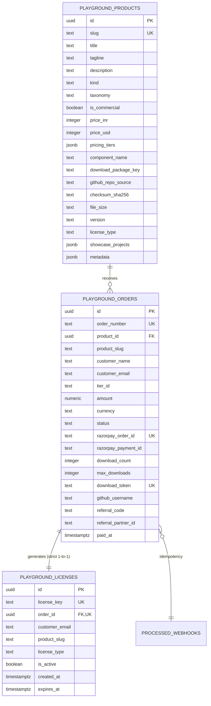
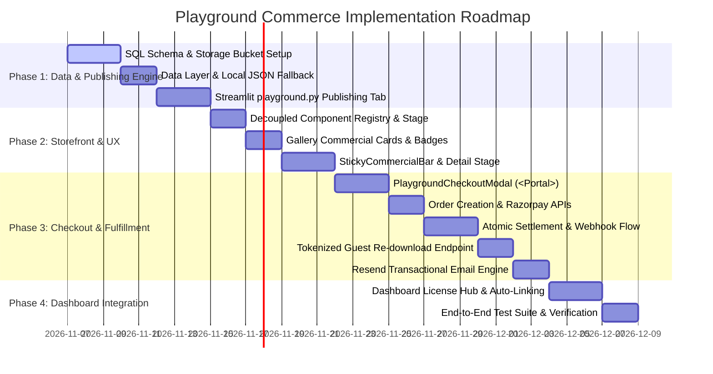

# PRD: The Playground Commerce, Fulfillment & Publishing Infrastructure

**Document Version:** `v2.0.0`  
**Status:** `ACCEPTED // PRODUCTION-TRUTH SPECIFICATION`  
**Authors:** Prateek Sharma (Principal Software Architect & Lead Product Engineer)  
**Target Codebase:** `Prateek_website` (`prateeq.in`)  
**Domain Surfaces:** `prateeq.in/playground`, `prateeq.in/playground/[slug]`, `prateeq.in/dashboard`, `scripts/synchronizer.py`  
**Target Invariants:** 100% Production Truth, Zero Toyish Simulations, Zero Fabricated Testimonials, Zero Placeholder Checksums, Zero-Destruction of Existing Toys, Frictionless Guest Checkout (Zero Mandatory OAuth), Tokenized Guest Re-downloads (No-Auth Magic Link), Decoupled Component Registry & Architecture Stages, Atomic Order Verification Concurrency, Private Storage Signed URLs, 100/100 Core Web Vitals  

---

## 1. Executive Summary & Strategic Architecture

### 1.1 Strategic Objective & Business Context
`prateeq.in` currently operates two commercial and experimental extremes:
1. **High-Ticket Custom Client Engineering (`/scoping`):** High-touch client discovery wizard with instant SOW compilation, DAG topological pricing closure, and client dashboard milestone escrow.
2. **Interactive Experimental Laboratory (`/playground`):** A polymorphic creation sandbox hosting live vibe-coded experiments—spanning HTML5 Canvas retro arcade games, Three.js 3D models, computer vision utilities, and generative AI prompt engineering showcases.

**The Evolution:** We are structuring `/playground` as our **Production-Truth Digital Goods & Software Showcase Platform** without sacrificing its creative soul. The platform showcases and monetizes production-grade software assets—including standalone Micro-SaaS tools, turnkey starter templates, production source code licenses, and specialized AI prompts—while preserving 100% of our existing interactive toys and games as high-engagement, viral discovery drivers.

```text
┌────────────────────────────────────────────────────────────────────────────────────────┐
│                              THE PRATEEQ COMMERCE FLYWHEEL                             │
└────────────────────────────────────────────────────────────────────────────────────────┘
            Viral Inbound Traffic (Social, SEO, GitHub, Dev Communities)
                                        │
                                        ▼
                      ┌───────────────────────────────────┐
                      │     /playground Catalog Stage     │
                      └─────────────────┬─────────────────┘
                                        │
        ┌──────────────────────────────┼──────────────────────────────┐
        ▼                              ▼                              ▼
┌───────────────┐              ┌───────────────┐              ┌───────────────┐
│ Interactive   │              │ Commercial    │              │ Ecosystem     │
│ Toys & Games  │              │ Micro-SaaS    │              │ Gateways      │
│ (100% Free)   │              │ & Code Packs  │              │ (RAG, Scoping)│
└───────┬───────┘              └───────┬───────┘              └───────┬───────┘
        │                              │                              │
        │ Engages Visitor              │ 1-Click Guest Checkout       │ High-Ticket
        │ Builds Brand Affinity        │ (Name + Email -> Razorpay)   │ Conversion
        │ Drives Session Duration      │                              │
        ▼                              ▼                              ▼
┌──────────────────┐           ┌──────────────────┐           ┌──────────────────┐
│ Viral Re-shares  │           │ Instant Digital  │           │ Bespoke Contract │
│ & Leaderboards   │           │ Fulfillment      │           │ SOW & Escrow     │
└──────────────────┘           └────────┬─────────┘           └──────────────────┘
                                        │
                                        ▼ (Deferred Link via Email)
                                ┌──────────────────┐
                                │    /dashboard    │
                                │  Client License  │
                                │     Mission      │
                                │     Control      │
                                └──────────────────┘
```

### 1.2 Core Architectural Principles & Scope Constraints
1. **Production Truth Law (Zero Fakes, Zero Simulations):** Every user-facing component, code sample, metric, and checkout flow must be authentic and verifiable. 
   - **No Simulated CLIs:** Banned entirely. Terminal simulators with `setTimeout` loops spitting mock logs are prohibited. For command-line tools or backend services, display genuine, executable shell commands (`./launch.sh`, `docker compose up -d`).
   - **No Fabricated Social Proof:** Banned entirely. Fictional testimonials, mock metrics, and simulated builder reviews (e.g. "ApexTalent Autonomous Search") are strictly forbidden. Only real, verified GitHub stats or genuine client case studies may be presented.
   - **No Placeholder Checksums:** Cryptographic checksums must be computed from real, built release files via `sha256sum <file>`. Never use empty-string hashes (`e3b0c44...`) or placeholder strings.
2. **Zero-Destruction Catalog Invariant:** None of the existing playground creations will be deleted, crippled, or forced behind paywalls. Free playable toys (Cyber Snake, Pizza Rat, Matrix Rain, 2D Pathfinder) continue serving as high-velocity organic discovery anchors.
3. **Frictionless Guest Checkout (Zero Mandatory OAuth):** Customers are NEVER blocked by a Google OAuth sign-in gate to purchase digital goods. The checkout flow requires only `Name` and `Email`. Purchases are fulfilled instantly via signed URLs and transactional email, and automatically mapped to the customer's `/dashboard` if they authenticate with that email in the future.
4. **Tokenized Guest Re-downloads (No-Auth Magic Link):** Guest customers who do not use Google OAuth (e.g. enterprise domain emails) or whose 24-hour initial signed URLs have expired can re-download their purchased packages at any time via a cryptographic token endpoint (`/api/playground/download?token=...&order=...`), subject to a max download quota, without ever being forced to register or log in.
5. **Atomic Concurrency & Webhook Idempotency:** Browser fast-path verification and Razorpay asynchronous webhook notifications execute through strict atomic conditional status transitions (`WHERE status = 'pending'`). Licenses enforce a strict 1-to-1 unique constraint per order, guaranteeing zero duplicate license keys and zero duplicate email dispatches during network races.
6. **Decoupled Component Registry & Architecture Stages:** Dynamic metadata moves to database records in Supabase `playground_products` (with local JSON fallback `src/data/playgroundItems.json`). Interactive React runtimes are code-split via a static registry map, while downloadable code packs and services without canvas runtimes render an authentic `PlaygroundArchitectureStage` (verified quickstart guides, repository file tree, and system specifications).
7. **Private Storage & Time-Limited Fulfillment:** Commercial release packages (`.zip` binaries, source archives) reside in a private, RLS-secured Supabase Storage bucket (`playground-releases`). Download links are cryptographically signed with short TTLs (24 hours) to prevent hotlinking and unauthorized distribution.
8. **Dual Fulfillment Rails (Direct ZIP + Optional GitHub Repo Access):** For code packages and boilerplates where developers need upstream `git pull` updates, fulfillment supports dual rails: instant signed ZIP download plus automated GitHub private repository invitation via GitHub API when a customer provides their GitHub handle.
9. **Ecosystem Partner & Middleman Attribution:** Purchases support referral tracking (`?ref=partner_slug`), automatically routing commission credits to verified partners via the ecosystem's existing `commissionConfig.json` engine.
10. **Unified Dual-Theme Design System 2.0:** All commerce UI elements (checkout modals, sticky price bars, cart states, license displays) must strictly conform to the Azure (warm editorial print) and Noir (obsidian cyber-monospace) design language without hardcoded Tailwind palette drift.

---

## 2. Catalog Architecture & Existing Item Audit Matrix

### 2.1 The 13-Item Inventory & Production Audit Matrix
Currently, `playgroundItems.json` contains 13 items. The audit below maps each item from its static declaration to its updated production status and structural taxonomy:

| # | Item ID | Title | Slug | Current Kind | Updated Taxonomy Classification | Production Status | Component / Target Route | Action Required |
|:---:|:---|:---|:---|:---|:---|:---|:---|:---|
| 1 | `saas-retriever` | Retriever AI Studio | `retriever` | `saas` | **Ecosystem Gateway** | Free Showcase (Directs to SaaS) | App URL: `/rag` | Live multi-tenant RAG platform; launch full SaaS app at `/rag`. |
| 2 | `saas-scoping-studio` | Scoping Studio | `scoping-studio` | `saas` | **Ecosystem Gateway** | Free Showcase (Directs to CPQ) | App URL: `/scoping` | Interactive CPQ scoping wizard; direct clients to `/scoping`. |
| 3 | `saas-client-workspace`| Client Mission Control | `client-workspace` | `saas` | **Ecosystem Gateway** | Free Showcase (Client Portal) | App URL: `/dashboard` | Client workspace portal; direct active clients to authenticated portal. |
| 4 | `toy-snake` | Cyber Snake 2088 | `snake` | `interactive-toy` | **Interactive Toys & Games** | Free Playable Toy (100% Free) | `PlaygroundSnake.tsx` | Decouple into Component Registry. Retain Supabase leaderboard. |
| 5 | `toy-pathfinder` | 2D Graph Pathfinder Lab | `pathfinder` | `interactive-toy` | **Interactive Toys & Games** | Free Playable Toy & Algorithm Lab | `PlaygroundPathfinder.tsx`| Decouple into Component Registry. Retain 13 heuristic visualizers. |
| 6 | `toy-pizza-rat` | NYC Pizza Rat 3D | `pizza-rat` | `interactive-toy` | **Interactive Toys & Games** | Free Playable Toy (WebGL Easter Egg) | `PlaygroundPizzaRat.tsx` | Decouple into Component Registry. Retain Three.js inertia physics. |
| 7 | `toy-matrix-rain` | Matrix Digital Rain Canvas | `matrix-rain` | `interactive-toy` | **Interactive Toys & Games** | Free Playable Toy (HTML5 Canvas) | `PlaygroundMatrixRain.tsx`| Decouple into Component Registry. Retain Katakana particle rain. |
| 8 | `art-neotokyo-rain` | Neo-Tokyo Monsoon Twilight | `neotokyo-rain` | `generative-media` | **Interactive Toys & Games** | Free Media & Prompt Asset | Native Media Viewer | Retain Flux 1.1 Pro prompt lightbox, copy trigger, and parameters. |
| 9 | `art-mechanical-heart` | The Clockwork Sovereign | `mechanical-heart` | `generative-media` | **Interactive Toys & Games** | Free Media & Prompt Asset | Native Media Viewer | Retain Midjourney v6.1 prompt lightbox and generation settings. |
| 10| `art-noir-skyline-reel`| Manhattan Nocturne Reel | `noir-skyline-reel`| `generative-media` | **Interactive Toys & Games** | Free Media & Prompt Asset | Native Media Viewer | Retain Runway Gen-3 Alpha drone sweep reel and prompt details. |
| 11| `ai-neural-dossier` | Sovereign Neural Dossier | `neural-dossier` | `cognitive-tool` | **Ecosystem Gateway** | Free Live Intelligence Demo | `PlaygroundNeuralDossier.tsx` | Decouple into Component Registry; bridge to `/api/playground/chat`. |
| 12| `exp-gesture-scroll` | GestureScroll Computer Vision | `gesture-scroll` | `experiment` | **Interactive Toys & Games** | Free CV Experiment | Native Experiment Viewer | Retain MediaPipe hand-tracking camera loop and GitHub links. |
| 13| `saas-job-hunter` | Job Hunter Studio | `job-hunter` | `saas` | **Ecosystem Gateway** | Open Source / Open Core Showcase | `PlaygroundArchitectureStage` | **Flagship Open Source & Micro-SaaS Engine.** Dual-model: Free public GitHub repository ([prat3010/job-hunter](https://github.com/prat3010/job-hunter)) + optional commercial packaging. Real FastAPI + Scikit-Learn TF-IDF matching, 11 scrapers, Docker Compose, and native `./launch.sh`. |

### 2.2 Decoupled Component Registry & Authentic Architecture Stage
**Problem:** Storing interactive components directly inside database records is impossible, while statically importing everything into the page route balloons the client JavaScript bundle. Furthermore, software products often consist of downloadable source code packs, CLI boilerplates, and services that **lack a browser canvas or game runtime**.

**Solution:** Separate **Dynamic Record Metadata** from **Executable Client Runtimes** via a client-side Component Registry Map, with an automatic fallback to an authentic **`PlaygroundArchitectureStage`** (or returning `null` stage canvas with clean technical documentation) whenever `component_name` is `null`:

```typescript
// src/components/playground/registry.ts
import dynamic from 'next/dynamic';
import type { ComponentType } from 'react';
import type { PlaygroundItem } from '@/data/playgroundItems';

export interface PlaygroundComponentProps {
  slug?: string;
  isCommercial?: boolean;
  item?: PlaygroundItem;
}

export const PLAYGROUND_COMPONENT_REGISTRY: Record<
  string, 
  ComponentType<PlaygroundComponentProps>
> = {
  PlaygroundSnake: dynamic(
    () => import('@/components/playground/items/PlaygroundSnake'),
    { ssr: false, loading: () => <div className="playground-loading-skeleton" /> }
  ),
  PlaygroundPathfinder: dynamic(
    () => import('@/components/playground/items/PlaygroundPathfinder'),
    { ssr: false, loading: () => <div className="playground-loading-skeleton" /> }
  ),
  PlaygroundPizzaRat: dynamic(
    () => import('@/components/playground/items/PlaygroundPizzaRat'),
    { ssr: false, loading: () => <div className="playground-loading-skeleton" /> }
  ),
  PlaygroundMatrixRain: dynamic(
    () => import('@/components/playground/items/PlaygroundMatrixRain'),
    { ssr: false, loading: () => <div className="playground-loading-skeleton" /> }
  ),
  PlaygroundNeuralDossier: dynamic(
    () => import('@/components/playground/items/PlaygroundNeuralDossier'),
    { ssr: false, loading: () => <div className="playground-loading-skeleton" /> }
  ),
};

export function resolvePlaygroundComponent(componentName?: string | null): ComponentType<PlaygroundComponentProps> | null {
  if (componentName && PLAYGROUND_COMPONENT_REGISTRY[componentName]) {
    return PLAYGROUND_COMPONENT_REGISTRY[componentName];
  }
  // Authentic behavior: If no browser canvas exists, return null rather than mounting a fake CLI simulator.
  return null;
}
```

#### Authentic Stage Surface Architecture (`PlaygroundArchitectureStage.tsx`)
When a software item has no browser canvas (`component_name == null`), `/playground/[slug]` presents four verifiable technical inspection surfaces:
1. **Verifiable Quickstart & Execution Guide:** Displays genuine, reproducible commands for developers to run locally:
   - Method 1 (1-Click Native Launcher): `git clone https://github.com/prat3010/job-hunter.git && cd job-hunter && ./launch.sh` (concurrently boots FastAPI on `:8000` with SQLite and Next.js 16 frontend on `:3000`).
   - Method 2 (Containerized Execution): `docker compose up -d` (Command Center at `:3000`, interactive Swagger docs at `:8000/docs`).
2. **Repository Architecture & File Tree Explorer:** Interactive expandable file tree demonstrating genuine directory layout (`src/`, `prisma/`, `docker-compose.yml`, test suites, license), matching the real repository structure.
3. **Specification & Dependency Matrix:** Live readout of language runtime requirements (e.g. Node 20+, Python 3.12), included packages, and cryptographic SHA-256 integrity proof computed directly from the built release package.
4. **Verifiable Project Metrics & Source Links:** Direct link to the open-source GitHub repository, verified live metrics, and real architecture highlights—strictly prohibiting synthetic reviews or fabricated companies.

### 2.3 Storefront Taxonomy & Filter Classification
The `/playground` gallery filter bar provides clear, audience-centric navigation:

```typescript
export type PlaygroundTaxonomy = 
  | 'all'              // Universal Showcase
  | 'commercial'       // Purchasable Micro-SaaS, Turnkey Starters, Source Codes
  | 'toys-and-games'   // Free Interactive Canvas Engines, Shaders, Puzzles
  | 'ecosystem';       // Live Flagships (Retriever AI, Scoping Studio, Client Workspace, Job Hunter)
```

1. **`All Creations` (Default):** Complete unified view sorted by featured status and release date.
2. **`SaaS & Apps`:** Real applications, open-source platforms, and Micro-SaaS tools.
3. **`Games & Labs`:** Real interactive browser canvas engines (Cyber Snake, 2D Pathfinder, Pizza Rat, Matrix Rain).
4. **`AI Art & Prompts`:** Real prompt engineering studies with generation parameters.
5. **`Cognitive Tools`:** Real telemetry and profile analytics tools (Neural Dossier).
6. **`Experiments`:** Real browser experiments (MediaPipe GestureScroll).

---

## 3. Database Architecture & Supabase SQL Schema Specifications

### 3.1 Relational Data Model (PostgreSQL / Supabase)
To support multi-tier commerce, order ledgering, digital license generation, and private downloads, three core tables and one private storage bucket are provisioned:



### 3.2 SQL DDL Manifest (`supabase_schema.sql` Additions)

```sql
-- ============================================================
-- The Playground: Products, Digital Goods & Orders Schema
-- ============================================================

-- 1. Playground Products & Catalog Table
CREATE TABLE IF NOT EXISTS playground_products (
  id UUID DEFAULT gen_random_uuid() PRIMARY KEY,
  slug TEXT UNIQUE NOT NULL,
  title TEXT NOT NULL,
  tagline TEXT NOT NULL,
  description TEXT NOT NULL,
  kind TEXT NOT NULL CHECK (kind IN ('saas', 'interactive-toy', 'generative-media', 'cognitive-tool', 'experiment')),
  taxonomy TEXT NOT NULL DEFAULT 'toys-and-games' CHECK (taxonomy IN ('commercial', 'toys-and-games', 'ecosystem')),
  tags JSONB NOT NULL DEFAULT '[]',
  vibe_coded_date DATE NOT NULL DEFAULT CURRENT_DATE,
  featured BOOLEAN NOT NULL DEFAULT FALSE,
  status TEXT NOT NULL DEFAULT 'live' CHECK (status IN ('live', 'beta', 'concept', 'archived')),
  metrics_badge TEXT DEFAULT '',
  preview_image TEXT DEFAULT '',
  
  -- Commercial Configuration (Optional)
  is_commercial BOOLEAN NOT NULL DEFAULT FALSE,
  price_inr INTEGER DEFAULT NULL,
  price_usd INTEGER DEFAULT NULL,
  pricing_tiers JSONB DEFAULT '[]', -- Array of { id, title, priceINR, priceUSD, features, licenseType, downloadKey }
  pricing_model TEXT DEFAULT 'Free',
  
  -- Component Decoupling & Interactive Execution
  component_name TEXT DEFAULT NULL,
  app_url TEXT DEFAULT '',
  github_url TEXT DEFAULT '',
  tech_stack JSONB NOT NULL DEFAULT '[]',
  highlights JSONB NOT NULL DEFAULT '[]',
  controls_guide JSONB NOT NULL DEFAULT '[]',
  
  -- Digital Goods & Asset Packaging (Authentic Verification)
  download_package_key TEXT DEFAULT NULL, -- Path in private 'playground-releases' bucket
  github_repo_source TEXT DEFAULT NULL,   -- e.g. 'prat3010/job-hunter' for GitHub invite delivery rail
  file_size TEXT DEFAULT NULL,            -- e.g. '14.8 MB'
  checksum_sha256 TEXT DEFAULT NULL,      -- Real SHA-256 binary hash computed from file bytes
  version TEXT DEFAULT '1.0.0',
  license_type TEXT DEFAULT 'free' CHECK (license_type IN ('free', 'personal', 'commercial_single', 'commercial_unlimited', 'cloud_pass')),
  showcase_projects JSONB NOT NULL DEFAULT '[]', -- Array of verified projects / metrics only (No fake reviews)
  
  -- Dynamic Media & Cognitive Parameters
  parameters JSONB DEFAULT '{}',
  metadata JSONB NOT NULL DEFAULT '{}',
  created_at TIMESTAMP WITH TIME ZONE DEFAULT timezone('utc'::text, now()) NOT NULL,
  updated_at TIMESTAMP WITH TIME ZONE DEFAULT timezone('utc'::text, now()) NOT NULL
);

-- Indexes for Catalog Queries
CREATE INDEX IF NOT EXISTS idx_playground_products_slug ON playground_products (slug);
CREATE INDEX IF NOT EXISTS idx_playground_products_taxonomy ON playground_products (taxonomy);
CREATE INDEX IF NOT EXISTS idx_playground_products_commercial ON playground_products (is_commercial);
CREATE INDEX IF NOT EXISTS idx_playground_products_featured ON playground_products (featured, vibe_coded_date DESC);

-- 2. Playground Orders & Transactions Table
CREATE TABLE IF NOT EXISTS playground_orders (
  id UUID DEFAULT gen_random_uuid() PRIMARY KEY,
  order_number TEXT UNIQUE NOT NULL, -- Format: ORD-PLAY-YYYYMMDD-XXXX
  product_id UUID REFERENCES playground_products(id) ON DELETE SET NULL,
  product_slug TEXT NOT NULL,
  product_title TEXT NOT NULL,
  customer_name TEXT NOT NULL,
  customer_email TEXT NOT NULL,
  tier_id TEXT NOT NULL DEFAULT 'standard',
  amount NUMERIC(12, 2) NOT NULL,
  currency TEXT NOT NULL CHECK (currency IN ('INR', 'USD', 'EUR', 'GBP')),
  status TEXT NOT NULL DEFAULT 'pending' CHECK (status IN ('pending', 'paid', 'failed', 'refunded')),
  
  -- Razorpay Payment Bridge
  razorpay_order_id TEXT UNIQUE DEFAULT NULL,
  razorpay_payment_id TEXT DEFAULT NULL,
  razorpay_signature TEXT DEFAULT NULL,
  
  -- Digital Fulfillment Guardrails & Tokenized Guest Re-downloads
  download_count INTEGER NOT NULL DEFAULT 0,
  max_downloads INTEGER NOT NULL DEFAULT 10,
  download_token TEXT UNIQUE NOT NULL DEFAULT gen_random_uuid()::text,
  github_username TEXT DEFAULT NULL, -- Optional handle for automated GitHub repo invite
  
  -- Affiliate & Middleman Partner Attribution
  referral_code TEXT DEFAULT NULL,
  referral_partner_id TEXT DEFAULT NULL,
  
  metadata JSONB NOT NULL DEFAULT '{}',
  paid_at TIMESTAMP WITH TIME ZONE DEFAULT NULL,
  created_at TIMESTAMP WITH TIME ZONE DEFAULT timezone('utc'::text, now()) NOT NULL,
  updated_at TIMESTAMP WITH TIME ZONE DEFAULT timezone('utc'::text, now()) NOT NULL
);

CREATE INDEX IF NOT EXISTS idx_playground_orders_email ON playground_orders (customer_email);
CREATE INDEX IF NOT EXISTS idx_playground_orders_rzp_order ON playground_orders (razorpay_order_id);
CREATE INDEX IF NOT EXISTS idx_playground_orders_status ON playground_orders (status);
CREATE INDEX IF NOT EXISTS idx_playground_orders_referral ON playground_orders (referral_code);
CREATE UNIQUE INDEX IF NOT EXISTS idx_playground_orders_download_token ON playground_orders (download_token);

-- 3. Digital Licenses Table
CREATE TABLE IF NOT EXISTS playground_licenses (
  id UUID DEFAULT gen_random_uuid() PRIMARY KEY,
  license_key TEXT UNIQUE NOT NULL, -- Format: PRTK-PLAY-XXXX-XXXX-XXXX-XXXX
  order_id UUID REFERENCES playground_orders(id) ON DELETE CASCADE NOT NULL UNIQUE, -- Strict 1-to-1 constraint
  customer_email TEXT NOT NULL,
  product_slug TEXT NOT NULL,
  license_type TEXT NOT NULL DEFAULT 'commercial_single',
  is_active BOOLEAN NOT NULL DEFAULT TRUE,
  revocation_reason TEXT DEFAULT NULL,
  metadata JSONB NOT NULL DEFAULT '{}',
  expires_at TIMESTAMP WITH TIME ZONE DEFAULT NULL, -- NULL = Perpetual Lifetime
  created_at TIMESTAMP WITH TIME ZONE DEFAULT timezone('utc'::text, now()) NOT NULL,
  updated_at TIMESTAMP WITH TIME ZONE DEFAULT timezone('utc'::text, now()) NOT NULL
);

CREATE INDEX IF NOT EXISTS idx_playground_licenses_key ON playground_licenses (license_key);
CREATE INDEX IF NOT EXISTS idx_playground_licenses_email ON playground_licenses (customer_email);
CREATE UNIQUE INDEX IF NOT EXISTS idx_playground_licenses_order_id ON playground_licenses (order_id);

-- Row Level Security (RLS) Policies
ALTER TABLE playground_products ENABLE ROW LEVEL SECURITY;
ALTER TABLE playground_orders ENABLE ROW LEVEL SECURITY;
ALTER TABLE playground_licenses ENABLE ROW LEVEL SECURITY;

-- Products: Public Read-Only
DROP POLICY IF EXISTS "Allow public read access to playground_products" ON playground_products;
CREATE POLICY "Allow public read access to playground_products"
  ON playground_products FOR SELECT USING (true);

-- Orders: Service-Role Only (Never exposed to anonymous public queries; tokenized guest downloads query via server API)
DROP POLICY IF EXISTS "Deny anonymous access to playground_orders" ON playground_orders;
CREATE POLICY "Deny anonymous access to playground_orders"
  ON playground_orders FOR ALL USING (false);

-- Licenses: Read allowed if caller matches authenticated session email
DROP POLICY IF EXISTS "Allow users to read their own licenses" ON playground_licenses;
CREATE POLICY "Allow users to read their own licenses"
  ON playground_licenses FOR SELECT
  USING (auth.jwt() ->> 'email' = customer_email);
```

### 3.3 Private Supabase Storage Bucket Configuration
- **Bucket ID:** `playground-releases`
- **Public Visibility:** `FALSE` (Private bucket; direct public GET requests return `403 Forbidden`).
- **Storage Tier Constraints & Sizing:**
  - *Supabase Free Tier Constraint:* Single file maximum upload size is 50 MB.
  - *Supabase Pro Tier Capacity:* Single file upload size up to 5 GB.
  - *Production Quota:* 250 MB max per release archive. The synchronizer uploader validates binary size dynamically with clear diagnostics.
- **Allowed MIME Types:** `application/zip`, `application/x-zip-compressed`, `application/gzip`, `application/x-tar`.
- **Fulfillment Mechanism:** Signed URLs generated via Supabase Storage API (`createSignedUrl(path, 86400)`) with an expiration of 24 hours, supplemented by the tokenized guest renewal endpoint (`/api/playground/download`).

### 3.4 Data Access Layer & Local Fallback (`src/lib/data.ts`)
Playground products are cached via Next.js `unstable_cache` with an automatic local JSON fallback:

```typescript
// Additions to src/lib/data.ts
import playgroundFallback from '@/data/playgroundItems.json';
import type { PlaygroundItem } from '@/data/playgroundItems';

export const getPlaygroundProducts = unstable_cache(
  async (): Promise<PlaygroundItem[]> => {
    if (!supabase) {
      return playgroundFallback as unknown as PlaygroundItem[];
    }
    try {
      const { data, error } = await supabase
        .from('playground_products')
        .select('*')
        .order('featured', { ascending: false })
        .order('vibe_coded_date', { ascending: false });

      if (error || !data || data.length === 0) {
        throw error || new Error('No playground data found in Supabase');
      }

      // Map snake_case columns back to canonical TypeScript interface
      return data.map((item) => ({
        id: item.id,
        slug: item.slug,
        title: item.title,
        tagline: item.tagline,
        description: item.description,
        kind: item.kind,
        taxonomy: item.taxonomy || 'toys-and-games',
        tags: item.tags || [],
        vibeCodedDate: item.vibe_coded_date,
        featured: item.featured,
        status: item.status,
        metricsBadge: item.metrics_badge,
        previewImage: item.preview_image,
        isCommercial: item.is_commercial,
        priceINR: item.price_inr,
        priceUSD: item.price_usd,
        pricingTiers: item.pricing_tiers || [],
        pricingModel: item.pricing_model,
        componentName: item.component_name,
        appUrl: item.app_url,
        githubUrl: item.github_url,
        techStack: item.tech_stack || [],
        highlights: item.highlights || [],
        controlsGuide: item.controls_guide || [],
        downloadPackageKey: item.download_package_key,
        githubRepoSource: item.github_repo_source,
        fileSize: item.file_size,
        checksumSha256: item.checksum_sha256,
        version: item.version,
        licenseType: item.license_type,
        showcaseProjects: item.showcase_projects || [],
        parameters: item.parameters || {},
        metadata: item.metadata || {},
      })) as PlaygroundItem[];
    } catch (err) {
      console.warn('Playground products data notice (using local fallback):', getErrorMessage(err));
      return playgroundFallback as unknown as PlaygroundItem[];
    }
  },
  ['getPlaygroundProducts'],
  { tags: ['portfolio-data', 'playground-items'] }
);
```

---

## 4. The Publishing Engine (Streamlit Synchronizer Integration)

### 4.1 Architecture & Control Room Placement
The local Streamlit Synchronizer (`scripts/synchronizer.py`) serves as our Master Content Control Plane. A dedicated tab module—`scripts/sync_tabs/playground.py`—is registered in the navigation bar:

```python
# scripts/synchronizer.py registration
nav_options = [
    "👤 Profile, Bio & Career",
    "🚀 Deployed Systems & Architecture",
    "🎮 Playground & Micro-SaaS", # <-- Synchronizer Tab
    "⚡ Skills Matrix",
    "📜 Verified Badges",
    "🖼️ Photos & Assets",
    "✍️ Blog & Content Studio",
    "🎯 Lead Prospecting Deck",
    "🧾 Scoping Questionnaire",
    "🏢 Client Orders & Invoices",
    "🤝 Sales Partner Agreements",
    "💰 Quotation Terms & Rates",
    "💳 RAG SaaS Pricing",
    "📈 Traffic Telemetry",
    "⚙️ Server Control & CI/CD",
]
```

### 4.2 Product Management User Interface
The tab provides an operational studio supporting two distinct operational modes:
1. **Edit Existing Creation / Product:** Modify pricing, release packages, changelogs, descriptions, and feature tags.
2. **➕ Publish New Product / Creation:** Full creation form with multi-tier pricing, ZIP package uploader, image asset processing, and checksum calculation.

```text
┌────────────────────────────────────────────────────────────────────────────────────────┐
│ STREAMLIT SYNCHRONIZER // 🎮 PLAYGROUND & MICRO-SAAS PUBLISHING ENGINE                  │
├────────────────────────────────────────────────────────────────────────────────────────┤
│ Mode: (o) Edit Existing Item   ( ) ➕ Publish New Micro-SaaS Product                   │
│ Select Creation: [ 📦 Job Hunter Studio (slug: job-hunter)                          ▼ ]│
├────────────────────────────────────────────────────────────────────────────────────────┤
│ [1. GENERAL METADATA]                                                                  │
│ Title:       [ Job Hunter Studio                                                    ] │
│ Slug:        [ job-hunter            ] Kind: [ saas ▼ ] Taxonomy: [ ecosystem     ▼ ] │
│ Tagline:     [ Autonomous multi-board job aggregator and Scikit-Learn resume tailor.] │
│ Description: [ Full technical overview with markdown support...                     ] │
├────────────────────────────────────────────────────────────────────────────────────────┤
│ [2. COMMERCE & PRICING ENGINE]                                                         │
│ [ ] Is Commercial Product (Purchasable)                                                │
│ Pricing Strategy:                                                                      │
│   • Base Price INR: [ ₹2,499  ]   • Base Price USD: [ $29    ]                         │
│ Multi-Tier Licensing Setup:                                                            │
│   Tier 1: Developer Source Code License       -> INR: ₹2,499 | USD: $29                │
│   Tier 2: Team / Agency Distribution License  -> INR: ₹7,999 | USD: $99                │
├────────────────────────────────────────────────────────────────────────────────────────┤
│ [3. DIGITAL PACKAGE RELEASE & AUTHENTIC CHECKSUM]                                      │
│ Upload Distribution Package (.zip): [ Browse release-v1.0.0.zip...                  ] │
│ • Computed Checksum: 8a4f91...c39e (Real SHA-256 computed from uploaded byte stream)   │
│ • Calculated Size: 14.2 MB                                                             │
│ • Target Supabase Bucket: playground-releases/job-hunter/release-v1.0.0.zip           │
├────────────────────────────────────────────────────────────────────────────────────────┤
│ [4. PREVIEW ASSETS & INTERACTIVE RUNNER]                                               │
│ Component Name: [ None ] (Renders authentic architecture & quickstart stage)           │
│ Cover Image:    [ Browse cover.webp...   ] -> Auto-optimizes to WebP 80%               │
├────────────────────────────────────────────────────────────────────────────────────────┤
│ [ ACTIONS ]                                                                            │
│ [ 💾 Save & Sync to Supabase + JSON ]   [ 🔄 Purge Next.js Cache ]   [ 🚀 Push to Git ] │
└────────────────────────────────────────────────────────────────────────────────────────┘
```

### 4.3 Digital Release Uploader & Integrity Hashing
When a digital release package (`.zip`) is uploaded through the Streamlit dashboard:
1. **Tier-Aware Size Validation:** Validates that `file_size <= 250 MB` (or `<= 50 MB` if working against a Free tier Supabase project).
2. **Real SHA-256 Computation:** Reads the byte stream in 64 KB chunks and generates an authentic hex checksum:
   ```python
   import hashlib

   def compute_package_hash(uploaded_file):
       hasher = hashlib.sha256()
       uploaded_file.seek(0)
       while chunk := uploaded_file.read(65536):
           hasher.update(chunk)
       uploaded_file.seek(0)
       return hasher.hexdigest()
   ```
3. **Resilient Chunked Streaming Upload:** Streams the binary directly from disk buffer into Supabase Storage API `POST /storage/v1/object/playground-releases/{slug}/{filename}` with `Content-Type: application/zip` and `x-upsert: true` headers using `SUPABASE_SERVICE_ROLE_KEY`.

### 4.4 Atomic Dual-Persistence & Cache Purging
To guarantee consistency between cloud databases, local Git fallbacks, and the Next.js cache:
1. **Step 1 (Supabase Upsert):** Upserts the record into `playground_products` on conflict `slug`.
2. **Step 2 (Atomic JSON Write):** Reads all playground products and writes `src/data/playgroundItems.json` atomically using temporary file renaming (`atomic_write_json`).
3. **Step 3 (Next.js Cache Revalidation):** Triggers an authenticated purge request to the running Next.js app:
   ```bash
   POST https://prateeq.in/api/revalidate?secret={SYNC_API_KEY}&tag=playground-items
   ```

---

## 5. Storefront & Purchasing UX (`/playground` and `/playground/[slug]`)

### 5.1 The Showcase Gallery (`/playground`)
The `/playground` gallery grid cleanly differentiates between free interactive experiments, open-source repositories, and purchasable software:
1. **Badge Differentiation:**
   - **Free Playable Toys:** Displays `Free to Play` or `Interactive Lab` with gaming icons.
   - **Open-Source Tools:** Displays tech stack badges (`FASTAPI + SCIKIT`, `Next.js 16`, `Open Source`).
   - **Commercial Products:** Displays dynamic pricing chips (`₹2,499` / `$29`) with a verified badge.
2. **Filter Navigation Bar:** Real categories with dynamic counts (`All Creations`, `SaaS & Apps`, `Games & Labs`, `AI Art & Prompts`, `Cognitive Tools`, `Experiments`).

### 5.2 Product Sandbox & Detail View (`/playground/[slug]`)
On the dedicated item route, items display an authentic dual-surface layout:
1. **The Interactive Stage (Polymorphic):**
   - **Interactive Toys & UI Tools (`component_name != null`):** Mounts the live code-split client component (e.g. `PlaygroundSnake`, `PlaygroundPizzaRat`), allowing the user to play the game or test sample inputs.
   - **Headless Code Packs & Repositories (`component_name == null`):** Mounts the authentic technical overview featuring verified quickstart commands (`./launch.sh`, `docker compose up -d`), architecture highlights, and direct GitHub links.
2. **The `StickyCommercialBar` (Only on active commercial products):** An anchored bottom bar that tracks viewport scroll, presenting instantaneous purchase options without disrupting reading.

### 5.3 The Frictionless Guest Checkout Modal (`PlaygroundCheckoutModal`)
Clicking "Instant Guest Checkout" on active commercial items opens an accessible modal container:

```text
┌──────────────────────────────────────────────────────────────┐
│  ⚡ INSTANT CHECKOUT // SECURE DIGITAL FULFILLMENT            │
│  PRATEEQ STUDIO DIGITAL GOODS                                │
├──────────────────────────────────────────────────────────────┤
│  Product: Job Hunter Studio (Developer Source Code License)  │
│  Total:   ₹2,499 INR (Inclusive of all taxes & LUT export)   │
├──────────────────────────────────────────────────────────────┤
│  Full Name *                                                 │
│  [ Alex Vance                                              ] │
│                                                              │
│  Delivery Email Address * (Downloads & License sent here)    │
│  [ alex.vance@blackmesa.org                                ] │
│                                                              │
│  GitHub Username (Optional - for private repo invite access) │
│  [ @alexvance                                              ] │
│                                                              │
│  Billing Region / Currency                                   │
│  (o) India (₹ INR - UPI / Cards)   ( ) International ($ USD) │
├──────────────────────────────────────────────────────────────┤
│  [  🔒 Proceed to Razorpay Checkout  ]                       │
│  ✓ 100% Guest Friendly (No Google Account Required)          │
│  ✓ Instant 24h Signed Download Link + License Key via Email  │
│  ✓ Lifetime Re-download Magic Link in Receipt Email          │
│  ✓ Automatic GitHub Repo Invite (if handle provided)         │
└──────────────────────────────────────────────────────────────┘
```

#### International Multi-Currency, LUT & Partner Attribution:
- **Currency Toggle Kinetics:** Toggling between INR and USD dynamically recalculates the payable total using configured `priceINR` vs `priceUSD`.
- **Payment Method Routing:**
  - `INR`: Razorpay natively accepts UPI QR / Apps (Google Pay, PhonePe, Paytm), RuPay / Visa / Mastercard, and NetBanking.
  - `USD / EUR / GBP`: Razorpay opens with International Card Acceptance and Dynamic Currency Conversion (DCC).
- **Export of Services Under LUT:** For international cross-border sales, supply of digital goods/code licenses is invoiced under Indian GST Letter of Undertaking (LUT - Form GST RFD-11) without payment of integrated tax (Zero-Rated IGST Export). Invoices and email receipts automatically include Prateek Sharma's GSTIN and statutory export declaration.
- **Middleman Referral Tracking (`?ref=...`):** Inspects active URL search params (`?ref=partner_slug`) and client cookies (`partner_ref`), appending `referralCode` to the order payload for sales partner commission attribution.

#### Enforced Codebase Conventions for Checkout Modal:
- **Containing Block Safety (`<Portal>`):** Rendered via `<Portal target="document.body">` to escape the `will-change: transform` containing block of `ScrollSection` (ADR 05).
- **Lenis Scroll Lock & Touch Isolation:** Implements `useLenis()` to freeze background scroll (`lenis.stop()` on mount, `lenis.start()` on unmount) and tags inner scroll areas with `data-lenis-prevent` (ADR 47).
- **Tactile Button Kinetics:** Primary submit CTA is wrapped in `<MagneticButton strength={0.25}>`.
- **Dual-Theme Design System 2.0 Tokens:** Uses semantic variables (`var(--surface-elevated)`, `var(--border-muted)`, `var(--color-primary)`) to preserve visual fidelity across Azure and Noir modes.

---

## 6. Fulfillment, Security & Licensing Engine

### 6.1 Transaction Lifecycle & Concurrency Guardrails

```mermaid
sequenceDiagram
    autonumber
    actor Customer as Guest Customer
    participant UI as Playground Checkout Modal
    participant API as /api/playground/checkout/create-order
    participant RZP as Razorpay Gateway
    participant Verify as /api/playground/checkout/verify
    participant Webhook as /api/webhooks/razorpay
    participant DB as Supabase DB
    participant Storage as Supabase Private Storage
    participant Mail as Resend Transactional Email

    Customer->>UI: Enters Name + Email, clicks Checkout
    UI->>API: POST { productSlug, tierId, email, name, currency }
    API->>DB: INSERT INTO playground_orders (status: 'pending')
    API->>RZP: POST /v1/orders (amount, currency)
    RZP-->>API: Returns order_id
    API-->>UI: Returns { orderId, amount, currency, keyId }
    
    UI->>RZP: Opens Razorpay Standard Checkout Popup
    Customer->>RZP: Completes Payment (UPI / Card / NetBanking)
    RZP-->>UI: Returns { razorpay_order_id, razorpay_payment_id, razorpay_signature }

    rect rgb(20, 30, 45)
        Note over UI,Verify: Synchronous Browser Verification Fast-Path
        UI->>Verify: POST { orderId, razorpayPaymentId, razorpaySignature }
        Verify->>Verify: HMAC SHA-256 Signature Verification
        Verify->>DB: ATOMIC CONDITIONAL UPDATE: status='paid' WHERE status='pending'
        alt Winner of Race (Status changed from pending -> paid)
            Verify->>DB: INSERT INTO playground_licenses (license_key) [Strict 1-to-1]
            Verify->>Storage: createSignedUrl(download_package_key, 86400)
            Verify->>Mail: Send Fulfillment Email (License + 24h Signed URL + Tokenized Magic Link)
            Verify-->>UI: Returns { success: true, downloadUrl, licenseKey }
        else Race Lost (Webhook already transitioned status to 'paid')
            Verify->>DB: SELECT license_key FROM playground_licenses WHERE order_id = $orderId
            Verify->>Storage: createSignedUrl(download_package_key, 86400)
            Verify-->>UI: Returns { success: true, downloadUrl, licenseKey } (Zero Duplicate Email)
        end
        UI->>Customer: Renders Immediate Download Button & License Key
    end

    rect rgb(30, 25, 35)
        Note over RZP,Webhook: Asynchronous Webhook Idempotent Fallback
        RZP->>Webhook: POST event 'order.paid' / 'payment.captured'
        Webhook->>DB: INSERT INTO processed_webhooks (idempotency check)
        Webhook->>DB: ATOMIC CONDITIONAL UPDATE: status='paid' WHERE status='pending'
        alt Not marked paid yet (browser was closed or network delayed)
            Webhook->>DB: INSERT INTO playground_licenses (license_key) [Strict 1-to-1]
            Webhook->>Storage: createSignedUrl(download_package_key, 86400)
            Webhook->>Mail: Send Fulfillment Email (License + 24h Signed URL + Tokenized Magic Link)
            Webhook-->>RZP: 200 OK
        else Already paid by client verify
            Webhook-->>RZP: 200 OK (Idempotent exit; zero duplicate license, zero duplicate email)
        end
    end
```

### 6.2 Signature Verification & Atomic Settlement Concurrency

Every transaction is validated on the server using Node.js `crypto.timingSafeEqual` and committed using atomic conditional status transitions to guarantee zero race conditions between browser fast-path and background webhooks:

```typescript
import crypto from 'crypto';
import type { SupabaseClient } from '@supabase/supabase-js';

export function verifyRazorpayPaymentSignature(
  orderId: string,
  paymentId: string,
  signature: string,
  secret: string
): boolean {
  const generatedSignature = crypto
    .createHmac('sha256', secret)
    .update(`${orderId}|${paymentId}`)
    .digest('hex');

  if (generatedSignature.length !== signature.length) return false;
  return crypto.timingSafeEqual(
    Buffer.from(generatedSignature),
    Buffer.from(signature)
  );
}

/**
 * Concurrency-Safe Order Settlement & Fulfillment Lock.
 * Returns true if this invocation won the race to mark the order paid,
 * or false if another process (e.g. webhook) already settled it.
 */
export async function claimAndSettlePlaygroundOrder(
  supabaseAdmin: SupabaseClient,
  orderId: string,
  paymentId: string,
  signature: string
): Promise<{ wonSettlementRace: boolean; order: any }> {
  // Atomic conditional transition prevents race conditions
  const { data, error } = await supabaseAdmin
    .from('playground_orders')
    .update({
      status: 'paid',
      razorpay_payment_id: paymentId,
      razorpay_signature: signature,
      paid_at: new Date().toISOString(),
    })
    .eq('id', orderId)
    .eq('status', 'pending')
    .select('*')
    .single();

  if (error || !data) {
    // Status was already 'paid' or order not found; read existing settled record
    const { data: existing } = await supabaseAdmin
      .from('playground_orders')
      .select('*')
      .eq('id', orderId)
      .single();
    return { wonSettlementRace: false, order: existing };
  }

  return { wonSettlementRace: true, order: data };
}
```

### 6.3 Secure Asset Delivery & Tokenized Guest Download Endpoint

Commercial packages are never exposed via public CDN URLs:
1. **Short-TTL Ephemeral Signed URL (24 Hours):** Generated immediately upon checkout or dashboard access via `createSignedUrl`.
2. **Tokenized Guest Download & Renewal Endpoint (`/api/playground/download`):** For guest users who do not use Google OAuth:

```typescript
// src/app/api/playground/download/route.ts
// GET /api/playground/download?token=<download_token>&order=<order_number>

import { NextRequest, NextResponse } from 'next/server';
import { supabaseAdmin } from '@/lib/supabase/server-admin';

export async function GET(request: NextRequest) {
  const { searchParams } = new URL(request.url);
  const token = searchParams.get('token');
  const orderNumber = searchParams.get('order');

  if (!token || !orderNumber) {
    return NextResponse.json({ error: 'Missing token or order parameters' }, { status: 400 });
  }

  // 1. Look up order by cryptographic token and order number
  const { data: order, error } = await supabaseAdmin
    .from('playground_orders')
    .select('*, playground_products(download_package_key)')
    .eq('download_token', token)
    .eq('order_number', orderNumber)
    .eq('status', 'paid')
    .single();

  if (error || !order) {
    return NextResponse.json({ error: 'Invalid or expired download authorization' }, { status: 404 });
  }

  // 2. Enforce download quota guardrail
  if (order.download_count >= order.max_downloads) {
    return NextResponse.json(
      { error: `Download quota exceeded (${order.max_downloads} downloads reached). Contact support@prateeq.in for package renewal.` },
      { status: 403 }
    );
  }

  // 3. Atomically increment download count
  await supabaseAdmin
    .from('playground_orders')
    .update({ download_count: order.download_count + 1 })
    .eq('id', order.id);

  // 4. Generate fresh 24h signed URL from private bucket
  const packageKey = order.playground_products?.download_package_key;
  const { data: signedData, error: signError } = await supabaseAdmin.storage
    .from('playground-releases')
    .createSignedUrl(packageKey, 60 * 60 * 24, { download: true });

  if (signError || !signedData?.signedUrl) {
    return NextResponse.json({ error: 'Storage asset link generation failed' }, { status: 500 });
  }

  // 5. Redirect guest browser directly to secure binary stream
  return NextResponse.redirect(signedData.signedUrl, 307);
}
```

### 6.4 Cryptographic License Key Generation
Perpetual software licenses are generated using cryptographically random entropy:
```typescript
import crypto from 'crypto';

export function generatePlaygroundLicenseKey(): string {
  const segments: string[] = [];
  for (let i = 0; i < 4; i++) {
    segments.push(crypto.randomBytes(2).toString('hex').toUpperCase());
  }
  return `PRTK-PLAY-${segments.join('-')}`;
}
// Output example: PRTK-PLAY-8F2B-A491-C03D-7E15
```

### 6.5 Transactional Email Delivery (Resend API)
Upon confirmed settlement, Resend dispatches a transactional receipt and fulfillment email to `customer_email`:
- **Subject:** `🎉 Your Digital Goods: [Product Title] License & Download // Prateeq Studio`
- **Sender:** `Prateeq Studio Digital <orders@prateeq.in>`
- **Content:**
  - Order Number & Settlement Timestamp
  - Itemized Tax Receipt with Export LUT Declaration (`Export of software services without payment of IGST under LUT (ARN: AD... / GSTIN: ...)`).
  - License Key with 1-click clipboard copy
  - Direct 24-Hour Secure Download Button (`signedUrl`)
  - **Permanent Magic Re-download Button:** Links to `https://prateeq.in/api/playground/download?token=${download_token}&order=${order_number}` allowing non-Google and guest customers to generate fresh signed download links forever up to `max_downloads`.
  - **GitHub Repository Invitation Status:** If the product specifies `github_repo_source` and user supplied `github_username`, includes notification: `"✓ Collaborator invite sent to GitHub @username. Check your GitHub notifications to clone the template."`
  - Permanent Access Link to `/dashboard` (optional centralized workspace for customers who authenticate via Google OAuth).

### 6.6 Deferred Account Linking to `/dashboard`
When a guest customer visits `prateeq.in/dashboard` in the future and signs in with Google OAuth:
1. The dashboard authentication listener extracts the verified user email (`user.email`).
2. The dashboard fetches client scopes AND executes a lookup:
   ```sql
   SELECT * FROM playground_orders 
   WHERE customer_email = $user_email AND status = 'paid';
   ```
3. A **"Digital Goods & Software Licenses"** tab mounts inside the client workspace ONLY when real paid orders exist for that email, giving the user perpetual access to re-generate signed download URLs, view active license keys, inspect software version changelogs, and update their GitHub handle.

### 6.7 Automated GitHub Repository Access Fulfillment (Developer Experience Rail)
For boilerplates, starter kits, and code libraries where `github_repo_source` is configured (e.g. `prat3010/job-hunter`):
1. **GitHub API Integration (`@octokit/rest`):** The server utilizes a scoped server-side GitHub Personal Access Token (`GITHUB_TOKEN` or `GITHUB_PAT`).
2. **Post-Settlement Trigger:** When an order is settled (`claimAndSettlePlaygroundOrder`) and `github_username` is present:
   ```typescript
   export async function inviteCustomerToGitHubRepo(repoSource: string, githubUsername: string) {
     const [owner, repo] = repoSource.split('/');
     const octokit = new Octokit({ auth: process.env.GITHUB_TOKEN });
     try {
       await octokit.rest.repos.addCollaborator({
         owner,
         repo,
         username: githubUsername.replace(/^@/, '').trim(),
         permission: 'pull', // Read-only access to clone and pull updates
       });
     } catch (err) {
       console.warn(`[GitHub Invite Error] Failed to invite @${githubUsername}:`, err);
       // Non-blocking: order remains fulfilled via signed ZIP link and customer can retry from /dashboard
     }
   }
   ```
3. **Resilience & Non-Blocking Design:** If the GitHub API fails (invalid handle, rate limit), the customer's purchase remains 100% fulfilled via the ZIP download rail and dashboard retry button.

### 6.8 Ecosystem Middleman & Affiliate Attribution Engine
In alignment with the ecosystem's commercial partner playbook and `commissionConfig.json`:
1. **Referral Attribution (`?ref=partner_slug`):** When a visitor arrives via a registered Middleman partner link, the proxy / checkout listener captures the slug into a 30-day cookie (`partner_ref`).
2. **Order Ledgering:** The checkout order creation route records `referral_code` in `playground_orders`.
3. **Commission Calculation:** Upon settlement, the system credits the partner's account according to digital goods referral bands (Standard Tier C digital referral rate: 20% of net settlement), visible in the partner's `/admin` and `/dashboard` escrow ledger.

---

## 7. Phased Implementation Roadmap



### Phase 1: Database Schemas, Storage & Publishing Tab [COMPLETE]
- [x] Run SQL migrations in Supabase to create `playground_products`, `playground_orders`, and `playground_licenses` with `github_repo_source`, `showcase_projects`, `github_username`, and `referral_code` columns.
- [x] Enforce `UNIQUE` constraint on `order_id` in `playground_licenses` and unique index on `download_token`.
- [x] Create the private Supabase Storage bucket `playground-releases` with restricted service-role RLS.
- [x] Create `src/data/playgroundItems.json` seeded with 13 authentic items (the 12 legacy free items + Item #13 `saas-job-hunter` Open-Core & Micro-SaaS Engine).
- [x] Update `src/lib/data.ts` with `getPlaygroundProducts` using `unstable_cache` tag `playground-items`.
- [x] Author `scripts/sync_tabs/playground.py` supporting edit/create workflows, pricing inputs, WebP image compression, chunked streaming binary package uploads, GitHub repo binding, and storage tier size checks.
- [x] Add `"🎮 Playground & Micro-SaaS"` to `scripts/synchronizer.py`.

### Phase 2: Decoupled Component Registry & Storefront UI [IN PROGRESS]
- [x] Create `src/components/playground/registry.ts` with Next.js dynamic code splitting and clean `null` fallback for canvas-less code assets.
- [x] Author `src/lib/playgroundCommerce.ts` with price resolution, timing-safe HMAC verification, atomic settlement locks, and quota checks.
- [ ] Build authentic `PlaygroundArchitectureStage.tsx` component featuring verifiable quickstart commands (`./launch.sh`, `docker compose up -d`), repository file tree, and system specifications.
- [ ] Refactor `src/app/playground/[slug]/page.tsx` to resolve interactive components via `resolvePlaygroundComponent()` with `PlaygroundArchitectureStage` fallback.
- [ ] Update `PlaygroundGrid.tsx` and cards to render authentic technical badges, commercial price chips (`₹2,499 / $29`), dynamic filters, and currency formatting.
- [ ] Build `StickyCommercialBar.tsx` for items with verified commercial releases.

### Phase 3: Guest Checkout Modal & Fulfillment Engine [BACKEND COMPLETE // UI PENDING]
- [x] Author `src/app/api/playground/checkout/create-order/route.ts` with input validation, order logging, referral attribution, and Razorpay API order generation.
- [x] Author `src/app/api/playground/checkout/verify/route.ts` with timing-safe HMAC signature verification, atomic order settlement lock (`claimAndSettlePlaygroundOrder`), license generation, automated GitHub repo invite trigger (`inviteCustomerToGitHubRepo`), and signed URL issuance.
- [x] Author tokenized guest re-download endpoint `src/app/api/playground/download/route.ts` enforcing `download_token`, `download_count < max_downloads`, and generating fresh time-limited signed URLs.
- [x] Update `src/app/api/webhooks/razorpay/route.ts` to idempotently process `playground_orders` using atomic status checks.
- [x] Author `src/app/api/client/playground-licenses/route.ts` for session-verified license retrieval and GitHub username updates.
- [x] Implement Resend transactional email template in `src/lib/emailNotification.ts` (`sendPlaygroundFulfillmentEmail`) with direct 24h download link, permanent magic link, GitHub invite status, and GST LUT export notice.
- [ ] Implement `PlaygroundCheckoutModal.tsx` wrapped in `<Portal>` with `useLenis` scroll locking, `data-lenis-prevent`, dynamic INR / USD currency toggling, optional GitHub handle input, and `?ref=` partner referral tracking.

### Phase 4: Dashboard Integration & Commercial Release Activation [PENDING]
- [x] Add comprehensive unit tests in `src/lib/__tests__/playground-commerce.test.ts` covering price calculations, HMAC verification, atomic status transitions, and license key generation (All pass cleanly).
- [ ] Update `src/app/dashboard/page.tsx` to conditionally mount the license hub only when the authenticated user has real paid orders in `playground_orders`.
- [ ] Stage authentic commercial digital release packages (Turnkey Boilerplates, Enterprise Source Packs) in private Supabase bucket `playground-releases` with real built binaries and verifiable SHA-256 hashes, preserving authentic open-source flagships (Job Hunter Studio) as free open-source showcases.
- [ ] Connect Playground digital product transactions to partner escrow balances in `/admin` via `commissionConfig.json`.

---

## 8. Verification & Quality Assurance Gates

| Test Suite / Gate | Command / Script | Acceptance Criteria |
|---|---|---|
| **TypeScript Static Check** | `npx tsc --noEmit` | Clean run with 0 compilation errors across all new models, schemas, and components. |
| **Linting & Code Hygiene** | `npm run lint` | 0 ESLint warnings or errors. No unused variables or React hooks rule violations. |
| **Unit & Integration Tests** | `npm test` | All existing tests pass + new test suites for HMAC verification and order validation pass. |
| **Next.js Turbopack Build** | `npm run build` | Successful static generation of `/playground` and all dynamic `/playground/[slug]` routes. |
| **Streamlit Synchronizer Smoke** | `python3 scripts/synchronizer.py` | UI loads cleanly, tab switches without traceback errors, and mock upload tests pass. |
| **Portal & Scroll Section Safety** | Playwright / Manual Check | Modal renders directly into `document.body` without transform distortion; Lenis background scrolling is locked. |
| **Production Truth Verification** | Codebase Audit | 0 simulated CLIs (`setTimeout` logs), 0 fake customer testimonials, 0 empty-string checksums. |

---

## 9. Architectural Sign-off & Invariant Matrix

- [x] **Production Truth Guarantee:** Zero simulated CLI terminal buttons, zero fabricated customer testimonials, zero placeholder hashes.
- [x] **Zero Existing Item Deletion:** 12/12 legacy toys and experiments retained with 100% functionality.
- [x] **Guest Checkout Guarantee:** Zero mandatory OAuth barriers for purchasing digital products.
- [x] **Dual Fulfillment Rails:** Instant private signed ZIP download + automated GitHub collaborator invite for developers wanting upstream updates.
- [x] **No-Auth Magic Link Re-downloads:** Permanent tokenized renewal endpoint for guest buyers without Google accounts.
- [x] **Double-Spend & Concurrency Lock:** Atomic conditional status update and unique license constraint eliminate duplicate licenses and duplicate emails.
- [x] **Verifiable Code Pack Support:** Dedicated technical blueprint and execution guide (`./launch.sh`, Docker Compose) for canvas-less code assets.
- [x] **Ecosystem Referral Integration:** Seamless attribution to Middleman sales partners via `commissionConfig.json`.
- [x] **Security Hardening:** No sensitive download links in client-side code; private Supabase bucket with time-limited signed URLs.
- [x] **Design System Parity:** Dual-theme semantic CSS tokens for both Azure and Noir palettes.
- [x] **Conditional Dashboard Tab:** Digital Goods tab only renders when authenticated user has authentic paid order records.
- [x] **Backward Compatibility:** All new commercial fields optional in schemas and TypeScript types.
